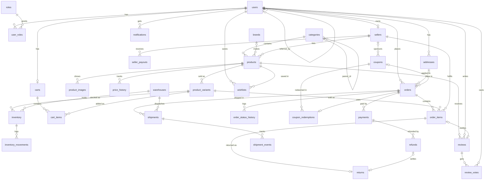

# Chapter 01 · DDL: designing the ShopSphere schema

[← Previous](../00_setup/README.md) · [Index](../../README.md) · [Next →](../02_seed_data/README.md)

## What you'll learn
- How the ShopSphere marketplace is modelled: 6 schemas and 33 tables
- **DDL** (Data Definition Language): `CREATE`, `ALTER`, `DROP`, `COMMENT`
- Data types, and which one to pick
- Constraints that protect data: `NOT NULL`, `DEFAULT`, `CHECK`, `UNIQUE`, `PRIMARY KEY`, `FOREIGN KEY`, `EXCLUDE`
- Identity columns, sequences, enums, domains, composite types and generated columns

Files: [schema.sql](schema.sql) is the real app schema. [queries.sql](queries.sql) holds the DDL lessons, run in a sandbox schema.

---

## The ShopSphere data model

ShopSphere is a multi-seller marketplace, like Amazon or Flipkart. **Buyers** browse a **category tree**, add product
**variants** to a **cart**, apply **coupons**, place **orders** and **pay** for them. **Warehouses** ship the orders,
items can be **returned** and **refunded**, and buyers write **reviews**. **Sellers** list products and receive monthly **payouts**.
Every click is recorded in a partitioned **events** table.

| Schema | Tables | Purpose |
|---|---|---|
| `core` | `users`, `roles`, `user_roles`, `addresses`, `sellers`, `seller_payouts`, `notifications` | people and accounts |
| `catalog` | `categories`, `brands`, `products`, `product_variants`, `product_images`, `price_history`, `reviews`, `review_votes` | what is sold |
| `logistics` | `warehouses`, `inventory`, `inventory_movements`, `shipments`, `shipment_events` | stock and delivery |
| `sales` | `carts`, `cart_items`, `wishlists`, `coupons`, `coupon_redemptions`, `orders`, `order_items`, `order_status_history`, `payments`, `refunds`, `returns` | money flow |
| `audit` | `audit_log` | change history (filled by triggers, ch17) |
| `analytics` | `events` (+ monthly partitions) | click-stream (ch18) |



### Design decisions worth noticing in [schema.sql](schema.sql)
| Feature | Where | Why |
|---|---|---|
| `bigint GENERATED ALWAYS AS IDENTITY` | every PK | standard auto-increment; can't be overwritten by accident |
| `uuid public_id` | `core.users` | never expose sequential ids in URLs |
| ENUM types | `order_status`, `payment_status`… | small fixed sets with a meaningful **order** (`'paid' < 'shipped'`) |
| DOMAINs | `core.email`, `core.phone`, `core.money_amount`, `core.rating` | one validation rule reused across tables |
| `citext` | emails, coupon codes | case-insensitive equality: `'SAVE20' = 'save20'` |
| Self-referencing FK | `users.referred_by`, `categories.parent_id` | trees and chains (recursive queries, ch08) |
| Composite PK | `user_roles`, `inventory`, `cart_items` | bridge tables / natural keys |
| Composite FK | `inventory_movements → inventory` | references a two-column key |
| Partial unique index | `addresses_one_default_per_user` | at most one default address per user |
| `EXCLUDE USING gist` | `seller_payouts_no_overlap` | no two payouts for one seller may overlap in time |
| Generated columns | `orders.grand_total`, `order_items.line_total`, `products.search_vector` | derived values that can never drift |
| `jsonb` | `users.preferences`, `products.attributes`, `orders.metadata` | flexible, schema-less attributes (ch12) |
| Arrays | `products.tags`, `reviews.image_urls` | small lists without a join table |
| Range types | `coupons.valid_during` (`tstzrange`), `seller_payouts.period` (`daterange`) | validity windows (ch20) |
| Partitioned table | `analytics.events` by month | big time-series data (ch18) |
| Denormalised `seller_id` on `order_items` | `sales.order_items` | fast seller reports and row-level security (ch19) |

---

## Concepts

### Schemas and `search_path`
A **schema** is a namespace inside a database, like a folder. `sales.orders` means the table `orders` in the schema `sales`.
`search_path` decides where unqualified names are looked up (**Q01.01–Q01.02**).

### Data types (Q01.03–Q01.04)
- Integers: `smallint` (2 bytes), `integer` (4), `bigint` (8). Use `bigint` for ids.
- `numeric(p, s)` is exact. **Always use it for money.** `real` and `double precision` are approximate (Q01.04).
- `text` is the normal string type. `varchar(n)` only adds a length limit, and `char(n)` pads with blanks, which is rarely what you want.
- Time: `timestamptz` stores an absolute moment (shown in your session's time zone). `timestamp` is a "wall clock" value with no zone. **Prefer `timestamptz`.**
- Others: `boolean`, `date`, `time`, `interval`, `uuid`, `bytea`, `inet`/`cidr`, `jsonb`, arrays (`text[]`), ranges.

### Constraints (Q01.05–Q01.10)
| Constraint | Guarantees |
|---|---|
| `NOT NULL` | a value must be present |
| `DEFAULT` | the value used when the column is omitted |
| `CHECK (expr)` | each row satisfies a condition; can span several columns at table level |
| `UNIQUE` | no duplicates. NULLs count as distinct unless you write `NULLS NOT DISTINCT` (PG15+) |
| `PRIMARY KEY` | `UNIQUE` + `NOT NULL`, and it identifies the row |
| `FOREIGN KEY … REFERENCES` | the value exists in the parent table |
| `EXCLUDE` | generalised uniqueness, e.g. "no overlapping ranges" |

Foreign-key **actions** decide what happens when the parent row is deleted or updated:
`NO ACTION`/`RESTRICT` (block it), `CASCADE` (delete or update the children too), `SET NULL`, `SET DEFAULT` (Q01.09).
`DEFERRABLE INITIALLY DEFERRED` postpones the check until `COMMIT` (Q01.10).

### Identity, serial, sequences (Q01.11–Q01.12)
A **sequence** is a counter object (`nextval`, `currval`, `setval`). `serial` and `bigserial` are older shorthand that creates one behind the scenes.
`GENERATED { ALWAYS | BY DEFAULT } AS IDENTITY` is the modern SQL-standard way: `ALWAYS` refuses manual values, while `BY DEFAULT` accepts them.

### Custom types (Q01.13–Q01.15)
- **ENUM**: an ordered list of labels. You can add labels later (`ALTER TYPE … ADD VALUE`), but you can't easily remove them.
- **Composite type**: a named record shape. Access its fields with `(col).field`.
- **DOMAIN**: a base type plus constraints, reusable across tables.

### Generated columns (Q01.16)
`GENERATED ALWAYS AS (expr) STORED` is computed on write. The expression must be **immutable**, so it can't call `now()`.

### Evolving tables: `ALTER TABLE` (Q01.17–Q01.21)
Add, rename and drop columns. Change types with `USING` to convert existing data. Toggle defaults and `NOT NULL`. Add constraints
`NOT VALID`, then `VALIDATE` them later, which avoids long locks on big tables. Rename tables and move them between schemas.

### Tables from tables (Q01.22–Q01.24)
`CREATE TABLE … AS SELECT` copies data, but not constraints. `CREATE TABLE … (LIKE other INCLUDING ALL)` copies the structure.
`TEMP` tables are private to your session. `UNLOGGED` tables skip the write-ahead log, so they are faster but are emptied after a crash.

### Documenting, inspecting, dropping (Q01.25–Q01.27)
`COMMENT ON` stores documentation inside the database (`\d+` shows it). `information_schema` is the SQL-standard catalog.
`DROP … RESTRICT` (the default) refuses to drop an object other objects depend on. `CASCADE` drops the dependents too, so use it carefully.

---

## Keywords & functions

| Keyword / function | What it does | Query IDs |
|---|---|---|
| `CREATE SCHEMA` / `DROP SCHEMA … CASCADE` | create or remove a namespace | Q01.01 |
| `SET search_path` / `SHOW` | choose name-resolution order / view a setting | Q01.02 |
| `CREATE TABLE` | define a table | Q01.03 |
| `smallint`, `integer`, `bigint`, `numeric`, `real`, `double precision` | numeric types | Q01.03, Q01.04 |
| `text`, `varchar(n)`, `char(n)` | string types | Q01.03 |
| `date`, `time`, `timestamp`, `timestamptz`, `interval` | time types | Q01.03 |
| `uuid`, `bytea`, `inet`, `cidr`, `jsonb`, `boolean` | other built-in types | Q01.03 |
| `::` | cast a value to a type | Q01.04 |
| `NOT NULL`, `DEFAULT`, `UNIQUE`, `CHECK`, `PRIMARY KEY` | column constraints | Q01.05 |
| `CONSTRAINT name` | name a (table-level) constraint | Q01.06 |
| `DO $$ … EXCEPTION … $$` | anonymous code block that catches an error | Q01.07 |
| `UNIQUE NULLS NOT DISTINCT` | treat NULLs as equal for uniqueness (PG15) | Q01.08 |
| `REFERENCES`, `ON DELETE CASCADE / RESTRICT / SET NULL`, `ON UPDATE CASCADE` | foreign keys and actions | Q01.09 |
| `DEFERRABLE INITIALLY DEFERRED` | check the constraint at commit | Q01.10 |
| `GENERATED … AS IDENTITY`, `serial`, `bigserial` | auto-numbered columns | Q01.05, Q01.11 |
| `CREATE SEQUENCE`, `nextval()`, `currval()`, `setval()` | counters | Q01.12 |
| `CREATE TYPE … AS ENUM`, `ALTER TYPE … ADD VALUE`, `enum_range()` | enums | Q01.13 |
| `CREATE TYPE … AS (…)`, `ROW()` | composite types | Q01.14 |
| `CREATE DOMAIN` | constrained alias type | Q01.15 |
| `GENERATED ALWAYS AS (…) STORED` | generated column | Q01.16 |
| `ALTER TABLE … ADD/RENAME/DROP COLUMN` | change columns | Q01.17 |
| `ALTER COLUMN … TYPE … USING` | convert a column's type | Q01.18 |
| `SET/DROP DEFAULT`, `SET/DROP NOT NULL` | change column rules | Q01.19 |
| `ADD CONSTRAINT … NOT VALID`, `VALIDATE CONSTRAINT` | add a constraint with low locking | Q01.20 |
| `RENAME TO`, `SET SCHEMA` | rename or move a table | Q01.21 |
| `CREATE TABLE AS`, `WITH NO DATA` | table from a query | Q01.22 |
| `LIKE … INCLUDING ALL` | copy a table's structure | Q01.23 |
| `TEMP`, `ON COMMIT DROP`, `UNLOGGED` | special table kinds | Q01.24 |
| `COMMENT ON`, `obj_description()`, `col_description()` | documentation | Q01.25 |
| `information_schema.columns` | standard metadata view | Q01.26 |
| `DROP … RESTRICT / CASCADE / IF EXISTS` | removing objects | Q01.27 |

## Gotchas
- **Floating point for money** gives rounding errors. Use `numeric`.
- `timestamp` (without time zone) silently ignores offsets. Use `timestamptz` for real events.
- `char(n)` pads values with spaces. `varchar(n)` vs `text` makes no performance difference in PostgreSQL.
- Unquoted identifiers are folded to lower case: `CREATE TABLE Orders` creates `orders`. Avoid quoted mixed-case names.
- PostgreSQL does **not** create indexes on foreign-key columns automatically. Add them yourself (schema.sql does).
- `ALTER TYPE … ADD VALUE` can't be undone easily, and the new value can't be used in the same transaction that added it.
- `DROP … CASCADE` can remove far more than you expect. Read the `NOTICE` it prints.
- `CREATE TABLE AS` doesn't copy constraints, defaults or indexes.

## Run it
```bash
scripts/psql.sh -e -f /playbook/chapters/01_ddl_schema/queries.sql
```
Then try [exercises.sql](exercises.sql) and check your work against [solutions.sql](solutions.sql).
